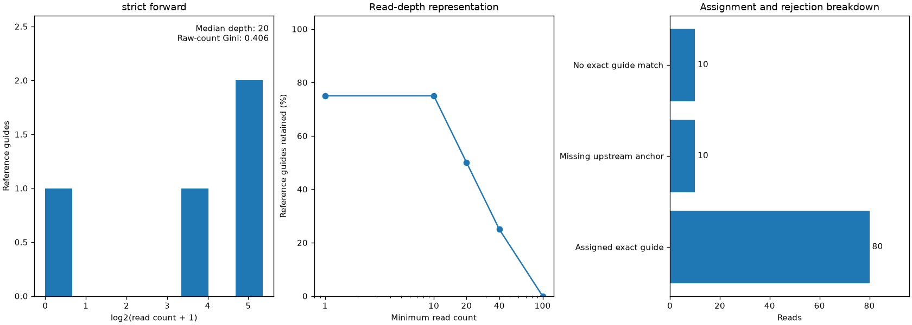

# READsparrow0.12.1

[](https://github.com/preedakornchun-del/READsparrow/actions/workflows/ci.yml)
[](https://doi.org/10.5281/zenodo.24332351)
[](LICENSE)

Streaming CRISPR guide counting and descriptive library quality control.
Stable release scope: **counting/QC**. Legacy gene-level statistical commands
remain experimental and do not carry a biological FDR guarantee.

## Install

Download the versioned wheel from the [v0.12.1 release](https://github.com/preedakornchun-del/READsparrow/releases/tag/v0.12.1)
and verify its SHA256 against the release's `SHA256SUMS.txt`:

```sh
python -m pip install 'readsparrow-0.12.1-py3-none-any.whl[plots]'
```

The wheel is the supported archived distribution route. A bare
`pip install readsparrow` is not claimed to work until this project is actually
published on PyPI. Core dependencies: NumPy/Pandas; optional plotting: Matplotlib;
optional legacy inference: SciPy; existing Excel support: openpyxl.
Python>=3.10 with compatible dependencies; the exact reference lock uses3.11.

From a tagged source checkout:

```sh
git clone https://github.com/preedakornchun-del/READsparrow.git
cd READsparrow
git checkout v0.12.1
python3.11 -m venv .venv
. .venv/bin/activate
python -m pip install -r requirements-lock.txt
python -m pip install --no-deps --no-build-isolation .
```

## Small reproducible example

```sh
python scripts/run_demo.py --output demo-output
```

This runs six100–112-read examples and checks independently specified expected
counts, QC JSON, rejection JSON and figure dimensions. Inputs/expected outputs,
including reference PNGs, are in [examples/tiny](examples/tiny/README.md).
Normally runs within a minute after installation; output folders are not overwritten.

```python
import readsparrow as rs
result = rs.count('examples/tiny/strict_forward.fastq',
                  'examples/tiny/reference.tsv', orientation='forward')
counts_df, qc, rejections = result
print(counts_df['count'].tolist())  # [40,25,15,0]
print(qc['mapping_rate_percent'])   #80.0
ax = rs.plots.abundance_distribution(counts_df)
```



## CLI

```sh
readsparrow count --library examples/tiny/reference.tsv \
  --fastq examples/tiny/strict_forward.fastq --sample demo \
  --orientation forward --output cli-output
readsparrow qc --counts cli-output/counts.tsv --output cli-qc
```

All original CLI commands remain available. Install `[legacy]` for experimental
`test`, `run` and `calibrate` statistical commands. Counting/CLI parser does not
import SciPy, Biopython, pysam or an aligner.

## Counting behavior

* Strict explicit forward/reverse, `anchor_mismatch=0`, dispatches to the original
  v0.12 loop. Count vectors/rejection categories match the preserved baseline.
* `orientation='auto'` inspects at most20000complete records, chooses a dominant
  orientation and reopens/counts once. Ties choose forward with a warning;
  zero support or<60% dominance also warns. Auto does not classify every read.
* `orientation='mixed'` tries forward then reverse, at most one count per read.
  Reverse-complement guide collisions do not overwrite guide identities.
* Opt-in `anchor_mismatch=1` allows one A/C/G/T substitution independently in each
  anchor. The spacer must match exactly. No indel or ambiguous-N rescue.
  A valid strict cassette takes priority over incidental approximate flank motifs.
* Canonical forward anchors: CACCG...GTTTT; reverse: AAAAC...CGGTG. Downstream
  searches begin after upstream_end+guide_length, protecting internal guide motifs.
* References accept TSV/CSV/DataFrame columns `sgRNA`, `Gene`, `Sequence` and
  documented aliases. All reference rows, including zero counts, retain their order.
  Duplicate guide DNA is rejected by anchor-bounded counting; legacy flex/variant
  group modes remain available for explicitly grouped measurements.

## QC and performance scope

QC reports mapping rate, representation, mean/median depth, zero guides and
separate raw/log1p-count Ginis. Mapping rate is unknown without input totals:
`rs.count` attaches totals to DataFrame attrs; for an external table supply
`rs.summarize_qc(df,total_reads=...)`. Operations discarding attrs require totals
again. Representation is guide-level representation, not cellular coverage.
Plots return Matplotlib Axes without saving/showing.

Strict counting memory is O(reference size+one read), independent of read count.
Legacy variant auditing can retain distinct variant strings and is outside that
bound. Historical alpha resource measurements and the actual40M-record check
are described in [Validation](docs/VALIDATION.md). That check used a1000-guide
reference and80repetitions of a500k engineering fixture; it is not independent
biological evidence or a full-genome-reference memory test. No general speed
advantage over ReCo/MAGeCK is inferred from these new API tests.

## Tests, environment and reproduction

```sh
python -m pytest -q --junitxml=regression.xml
python scripts/build_release.py
```

[Exact commands](docs/REPRODUCE.md) cover the example/figures, regression tests,
27-unit CPU/RAM harness, optional40M check, and wheel build. The small example
is suitable for CI; large resource checks are optional and are not run in CI.
`requirements-lock.txt` pins all dependencies used in the reference3.11 environment.
Local release checks pass216test items+98subtests. The live badge reports actual
GitHub Actions status; it is not a hard-coded success image.

## Licence and citation

MIT, copyright2026Preedakorn Chunhacha. Creator ORCID:
https://orcid.org/0000-0002-5060-7113 . See [CITATION.cff](CITATION.cff) and
`.zenodo.json`. The published version-specific archive is
[Zenodo 10.5281/zenodo.24332351](https://doi.org/10.5281/zenodo.24332351).

Chunhacha, P. (2026). READsparrow v0.12.1: streaming CRISPR guide counting and
quality control (0.12.1) [Software]. Zenodo. https://doi.org/10.5281/zenodo.24332351

The archive identifies the immutable `v0.12.1` tag; later citation-only main-branch
updates do not change that tagged source or its archived wheel.

The original alpha, historical results, failed attempts and prior manuscripts
remain preserved in the original workspace. Public release contents are selected
software/example/reproduction artifacts, not a dump of private research workspace.
